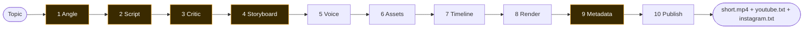
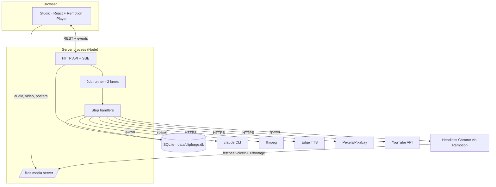
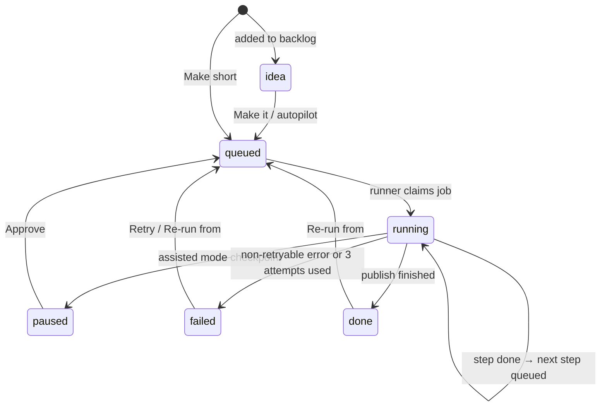
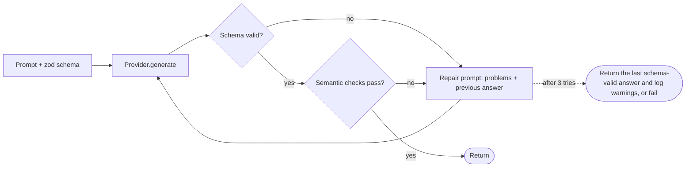

# How ClipForge works

How a topic becomes a finished short, step by step. Covers what each part does, why it was built that way, and where to change it.

---

## 1. The big picture



Amber steps use the LLM. The rest are deterministic code: TTS, ffmpeg, Remotion and file work.

Three ideas hold the design together:

1. **The LLM never writes animation code.** It fills in *props* for eight hand-built animation templates. Hand-built templates look consistent, can't produce a broken render, and a model is far better at choosing "diagram with these 4 boxes" than at writing reliable React animation.
2. **Animations are anchored to spoken words, not timestamps.** A storyboard says "reveal the *pointer* box when the voice says *pointers*". The real timing comes from the voice engine afterwards. Change the voice, speed or pauses, and every animation re-syncs on its own.
3. **Every step is a durable job, and its output is a saved artifact.** Steps talk to each other only through artifacts in SQLite. So a crash resumes where it stopped, a failure retries just one step, and any step can be re-run without redoing the ones before it.

## 2. Architecture

```
apps/server      Hono HTTP API · SQLite job runner · the 10 steps · LLM/TTS/stock/render/publish adapters
apps/studio      Vite + React UI: start videos, watch live progress, preview, copy metadata
packages/schema  zod schemas + shared types + pure timing utilities (used by all three others)
packages/video   Remotion: brand kit, 8 scene templates, captions, the Short composition
```



- **The server is one process.** It holds the API, the job runner, the SSE event stream and the media file server.
- **Heavy work runs in child processes.** `claude` for writing, `ffmpeg` for audio, and Remotion's headless Chrome for frames.
- **The studio and the renderer share one video component.** The same `ShortVideo` React component plays live in the studio (Remotion Player) and renders to MP4 on the server. What you preview is what you get.

## 3. Data model

| Table | Holds | Notes |
|---|---|---|
| `projects` | One row per short or idea: topic, title, status, current step, mode | `status` is one of `idea → queued → running → (paused) → done / failed` |
| `artifacts` | JSON output of every step run | Append-only; the newest row per step is "current", older rows are history |
| `jobs` | The queue: one row per attempted step | `queued → running → done / failed / cancelled`, with attempts, progress and `run_after` for backoff |
| `logs` | Human-readable pipeline log per project | Shown in the studio and printed by the CLI |
| `spend` | Every LLM call: provider, model, tokens, ₹ cost, billed? | Drives the monthly budget cap |

**The artifact contract between steps:**

| Step | Reads | Writes (artifact) |
|---|---|---|
| angle | topic | `AnglePlan` (4 angles and the chosen one) |
| script | angle | `Script` (scenes with narration and a visual idea) |
| review | script | `Review` (scores, issues, final `Script`) |
| storyboard | review.script | `Storyboard` (template, props, cues per scene) |
| voice | review.script | `VoiceArtifact` (audio file and word timings per scene) |
| assets | storyboard | `AssetsArtifact` (footage, code colors, music) |
| timeline | review, storyboard, voice, assets | `Timeline` (render-ready, all in frames) |
| render | timeline | `RenderArtifact` (final.mp4, poster, size) |
| metadata | review.script | `Metadata` (titles, description, tags, IG caption) |
| publish | render, metadata, assets | `PublishArtifact` (export folder, YouTube link) |

Media files live under `data/projects/<id>/`. Artifacts store paths *relative to* `data/`, and the server serves them at `/files/...`. Only the `projects/`, `library/` and `exports/` folders are exposed; the database and `secrets/` never are.

## 4. The job runner



- **Two lanes.** `render` has its own lane, and every other step runs in `default`. Each lane runs one job at a time, so a 2-minute render never blocks the next video's writing steps.
- **Atomic claim.** A lane picks the oldest `queued` job whose `run_after` has passed and marks it `running` inside one SQLite `IMMEDIATE` transaction, so two processes can never grab the same job.
- **Advance.** When a step succeeds, its output is saved, the job is marked `done`, and the next step is queued. The last step marks the project `done`. In *assisted* mode, steps listed in `pause_after` stop at `paused` until approved. The engine supports this, but the studio's editing screens don't exist yet.
- **Retries.** Errors are retryable by default (network blips, timeouts). The job is re-queued after 5s, then 10s, for up to 3 attempts. Errors raised as `StepError(…, retryable=false)` fail straight away: missing API key, budget used up, model output still invalid after repair.
- **Crash recovery.** On startup, any job left `running` goes back to `queued` without using up an attempt. Restarting in the middle of a step simply runs that step again.
- **Guards.** Re-running while a step is running is refused. Starting a project cancels its leftover queued jobs first, so there's never more than one chain per project.
- **Autopilot** (`AUTOPILOT_HOURS`) is a 10-minute timer. When the interval has passed and nothing is queued or running, it starts the top backlog idea.

## 5. The steps in detail

### 1 · Angle
Asks for 4 genuinely different angles (myth-busting, "what actually happens when…", a shocking number, a relatable Indian situation, a "you've been using it wrong" twist). Each has a hook line (14 words max), a title, a promise and an analogy. The model then picks the angle most likely to stop a scroll and says why. *Why:* the hook decides whether anyone watches, so choosing among options beats accepting the first idea.

### 2 · Script
Writes 5–9 scenes totalling **110–165 words**. At the voice's pace that comes to 45–70 seconds after pause trimming. Scene 1 is the hook (14 words max); each scene is one visual beat (30 words max) with a one-line visual idea. The **voice guide** (`agents/prompts.ts`) is shared by every writing agent:
- **Persona and language:** a witty senior-engineer friend explaining over chai, in simple Indian-urban English.
- **Humour rules:** no punching down, no politics, mild words only.
- **Banned filler:** phrases like "Let's dive in".
- **Structure:** hook → setup → reveal → payoff → loop-back ending.
- **Accuracy:** prefer "roughly/usually" over invented numbers.
- **Written for text-to-speech:** "sixteen gigs", never "16GB".

### 3 · Critic pass
A separate "toughest editor" prompt scores the draft on hook, clarity, accuracy, pacing and wit. It lists concrete issues (factual problems first) and returns the fixed final script. *Why:* in full-auto mode nobody reviews the script, so this step takes that role. In testing it consistently caught real errors, for example that WhatsApp forwarding doesn't re-compress a photo, and that Windows Task Manager *does* show compressed memory. Everything downstream uses `review.script`, not the draft.

### 4 · Storyboard
For each scene the model picks **one template** and fills its props. It also writes **cues**: `{ word, action, target }`, meaning "when this word is spoken, do this to that element".

| Template | Used for | Cue targets |
|---|---|---|
| `HookSlam` | Scene 1 only: giant slamming text, icon, kicker tag | `shake` |
| `KineticText` | Punchline, definition or joke as big animated words | `pulse` |
| `Diagram` | How things work: nodes on a 3×5 grid, arrows, moving data packets | `reveal`/`highlight` `node:<id>`, `reveal`/`packet` `edge:<a>-<b>` |
| `CodeBlock` | Real code, typed out with syntax colors | `highlight line:<n>` |
| `Compare` | A vs B cards with a verdict | `reveal left/right/verdict` |
| `ListReveal` | Steps, reasons, "N ways" | `reveal item:<n>` |
| `StatCounter` | One number counting up (Indian digit grouping) | `pulse` |
| `Media` | Stock footage or photo (only when stock keys exist) | `zoom` |

Icons are either an emoji or `lucide:<name>` from a vetted list of about 150.

### 5 · Voice
For each scene:

1. **Pronunciation.** Displayed words become spoken text with character spans kept, for example `macOS → "mac O S"`, `16GB → "16 gigabytes"`, `SQL → "sequel"` (`tts/lexicon.ts`).
2. **Synthesis.** Edge's `en-IN-PrabhatNeural` speaks it at +15% and reports a **word boundary** (start and duration) for every spoken word.
3. **Alignment.** Each boundary is located in the spoken text, then mapped back onto the *displayed* word that owns that span (`tts/align.ts`). "mac", "O" and "S" all become one timed word, `macOS`. Any word the voice didn't report is interpolated.
4. **Jump-cut pacing.** ffmpeg finds silences (below -40 dB, over 0.2s). Every *interior* pause longer than `PAUSE_MAX_MS` (300ms) is cut down to 300ms, and word times are shifted by the removed amounts (`media/tighten.ts`). Edge pauses about 0.8s after each sentence, so this alone cut roughly 9s from a test video. The audio is re-chunked into fresh frames before MP3 encoding, because trimmed frames can crash libmp3lame. A real clip that triggered this is kept as a regression test.
5. **Fallback chain.** Edge → Azure (if a key is set) → macOS `say` (estimated timings). The provider that voices scene 1 is used for every scene, so the voice never changes mid-video.

### 6 · Assets
- **Sound effects.** A licence-free SFX kit (whoosh, pop, slam, ding) is generated once with ffmpeg math. There are no downloads and no licensing questions.
- **Stock footage.** For `Media` scenes, Pexels then Pixabay is searched, preferring portrait video over 4s and falling back to a photo. The file is downloaded, and its credit goes into the YouTube description.
- **Code highlighting.** Code is colored on the server with Shiki (One Dark Pro), so the video only paints pre-colored tokens.
- **Music.** A background track is picked from `data/library/music/` if you've added any.

### 7 · Timeline
Pure code that turns everything into frames at 30 fps (`pipeline/timeline.ts`):

- **Scene length** = the smaller of (audio length) and (last spoken word + 260ms), with a 1.2s minimum. The last scene gets an extra 0.7s hold. Scenes sit back to back.
- **Cues:** for each cue, find its word in that scene's timed words. An exact multi-word match wins; otherwise a prefix match ("compress" ↔ "compression"). The match fires 3 frames before the word, so the motion leads the voice slightly, which feels synced. Cues whose word is never spoken are spread evenly and logged as a warning.
- **Captions:** all words shifted onto the global clock and grouped into pages of up to 3 words or 18 characters. A new page starts at sentence ends, after commas, and after pauses over 280ms. Each page stays up until the next begins (at most 450ms extra), so captions never flicker.
- **Sound effects:**
  - a whoosh on every scene change
  - a slam when the hook lands
  - a pop on each reveal or packet (at least 8 frames apart)
  - a ding when a stat lands
- **Diagram cleanup:** duplicate ids are dropped, two boxes in the same cell are nudged to the nearest free cell, and arrows to missing boxes are removed.
- **Cache-busting:** voice URLs get `?v=<duration>`, so a re-voiced scene is never played from a stale browser cache.

### 8 · Render
1. The video package is bundled with webpack and the bundle is cached. It's rebuilt only when files in `packages/video` or `packages/schema` change.
2. Remotion's headless Chrome renders 1080×1920 H.264 (CRF 20). Audio, footage and SFX are fetched from the server's `/files`.
3. ffmpeg normalizes loudness to **-14 LUFS** (true peak -1.5 dB), the level Shorts and Reels play at, and moves the index to the front for fast start.
4. A half-size JPEG poster is taken at frame 40 (the hook).

### 9 · Metadata
Generates 3–5 titles (60 characters max, key term first, honest), a YouTube description with a follow line, 3–5 hashtags ending in `shorts`, 8–15 search tags, and an Instagram caption with 3–5 hashtags. Hashtags are cleaned (no `#`, no spaces, lowercase).

### 10 · Publish
- **Export folder.** Writes `data/exports/<date>-<title>-<id>/`. The MP4 and poster are hard-linked, so they take no extra space. Re-publishing replaces that project's previous export.
- **YouTube upload (when connected).** A resumable upload to the YouTube Data API: category *Science & Technology*, not made for kids, privacy from `YOUTUBE_PRIVACY`. Titles and descriptions have `<` and `>` removed (YouTube rejects them), and tags are trimmed to fit YouTube's 500-character tag budget.
- **Instagram.** Instructions only; auto-posting is deliberately off.

## 6. The LLM layer

Every writing step calls `generateStructured(schema, prompt, checks)` (`llm/index.ts`):



- **Structured output.** Each schema (zod) is turned into JSON Schema: the CLI gets it through `--json-schema`, Anthropic through `output_config.format`, Gemini through `responseJsonSchema`, OpenAI through `json_schema`. The answer is always validated again with zod.
- **Semantic checks** (`agents/checks.ts`) catch what a schema can't:
  - word count and scene ids
  - unit symbols in narration
  - `HookSlam` only in scene 1, and `Media` only when stock keys exist
  - cue words that actually appear in that scene's narration
  - diagram arrows pointing at real boxes
  - code length
  - icon names on the vetted list
- **The `claude-cli` provider** runs `claude -p` in a temp folder with:
  - a minimal environment
  - no tools (`--tools ""`) and no MCP servers
  - no session saved to disk
  - **only project settings** (`--setting-sources project`), so your personal Claude Code hooks and settings never run inside the pipeline
- **The budget ledger** records every call. Paid providers are refused once the calendar month's billed ₹ reaches `MONTHLY_BUDGET_INR`.

## 7. Timing, end to end (a worked example)

The narration `"Your macOS squeezes memory before it touches the disk. That's why 16GB feels bigger."` goes through the voice step like this:

| Stage | Result |
|---|---|
| Lexicon | `Your mac O S squeezes memory … That's why 16 gigabytes feels bigger.` |
| Edge boundaries | `Your@93ms mac@343 O@… S@… squeezes@1170 …` |
| Alignment | `macOS` = 343ms to the end of "S"; `16GB` covers both spoken words, "16 gigabytes" |
| Pause trim | The ~0.8s gap after "disk." shrinks to 0.3s, so every later word moves about 0.5s earlier (`16GB` ends at 4362 to 5547ms) |
| Scene length | Last word end + 260ms |
| Cue `{ word: "disk", action: "reveal", target: "node:ssd" }` | "disk" at 3180ms → frame 95 → fires at frame 92 |
| Captions | `Your macOS squeezes` · `memory before it` · `touches the disk.` · … |

## 8. The video engine (`packages/video`)

The `Short` composition is a stack of layers, bottom to top:

1. **Background:** near-black gradient, two slowly drifting glows (amber and blue), a dot grid, a vignette.
2. **Scenes:** each is a `<Sequence>` wrapped in `SceneShell`, which adds a spring entrance, a slow 3% camera drift, and cue-driven *shake* and *zoom*. Inside sits the template chosen for that scene.
3. **Captions:** 86px Bricolage Grotesque with a thick outline. The word being spoken turns amber.
4. **Progress bar:** thin amber line along the top.
5. **Audio:** each scene's voice inside its `<Sequence>`, SFX at their frames, and looping music at 8% volume.

**Brand kit** (`brand.ts`, `fonts.ts`):
- **Colors:** background `#090B10`, text `#F5F7FB`, accent amber `#FFB224`, plus blue, green and red tones.
- **Fonts:** Bricolage Grotesque (display), Inter (body), JetBrains Mono (code), loaded through Remotion's Google Fonts loader so renders wait for them.
- **Safe zone:** content stays within x 72–1008 and y 210–1130, and captions sit around y 1275. That keeps everything clear of the YouTube Shorts and Reels top bar, bottom title block and right-hand buttons.

## 9. The studio

- **Data:** React Query fetches projects and status. An `EventSource` on `/api/events` receives `project`, `progress` and `log` events and refreshes the affected queries at most every 0.7s.
- **Preview:** shows the rendered MP4 when it exists (and switches to it automatically when a render finishes). Otherwise it plays the timeline live in the Remotion Player.
- **Resilience:** each page and the header sit inside an error boundary, so one bad component shows an error card instead of blanking the app.

## 10. Design decisions

| Decision | Why | Revisit when |
|---|---|---|
| TypeScript everywhere + Remotion | One language; the same component is both the live preview and the renderer; data-driven video | You need Manim-style maths animation (render it separately and drop it in as a clip) |
| Templates + props, not generated code | Consistent brand, can't break a render, easy for a model to fill | A template keeps being missing: add it to the catalog |
| Word-anchored cues | Survives voice, speed and pause changes; enables recording your own voice later | – |
| SQLite jobs table instead of Redis/BullMQ | One user, a few videos a week; durable and inspectable with nothing extra to run | Many videos in parallel or several machines |
| Critic pass | Stands in for human review in auto mode; catches factual errors | Assisted mode lets you review yourself |
| `claude` CLI as the default writer | Zero keys, uses your existing plan | You want per-token billing or other providers: set a key |
| Edge TTS by default | Free, natural Indian-English voices, word timings included | It breaks: add `AZURE_SPEECH_KEY` (same voices, official) |
| Pause trimming to 300ms | Shorts pacing; Edge pauses ~0.8s per sentence | You prefer a calmer read: raise `PAUSE_MAX_MS` |
| Procedural SFX | No licences, no downloads | You want richer sound: drop real files into `library/sfx` with the same names |
| YouTube private, Instagram off | Nothing goes public without you looking at it | You trust autopilot enough to publish directly |
| zod pinned to 4.5.4 | Remotion 4.0.529 requires that exact version | You upgrade Remotion |

## 11. Extending

**Add a template**
1. Add its props schema and a `TEMPLATE_GUIDE` entry in `packages/schema/src/templates.ts`, and include it in the `StoryboardSceneSchema` union and `TimelineScene` type.
2. Build the component in `packages/video/src/templates/` (use `ContentArea`, `springAt` and `cueFrames`), and register it in `templates/index.tsx`.
3. If it needs server-side preparation, resolve it in `pipeline/timeline.ts` (`resolveProps`).
4. Add semantic checks in `agents/checks.ts` if the model could misuse it.
5. Preview with `pnpm remotion`, then re-run a project from *Sync timeline*.

**Add an LLM provider:** implement `LlmProvider` (`llm/types.ts`), add a price to `llm/pricing.ts`, and select it in `llmProvider()`.

**Add a voice provider:** implement `TtsProvider` (return audio plus word boundaries) and add it to `ttsChain()`.

**Add a step:** add it to `STEPS` and `STEP_LABELS`, give it an artifact type in `ArtifactMap`, write the handler, and register it in `pipeline/registry.ts`.

## 12. Tests

| Test file | Covers |
|---|---|
| `tts/align.test.ts` | Pronunciation spans; merging multi-token words; interpolating unreported words |
| `media/tighten.test.ts` | Pause planning and remapping word times across cuts |
| `media/tighten.ffmpeg.test.ts` | Real ffmpeg cuts on synthetic audio and on the Edge clip that once crashed the encoder |
| `pipeline/timeline.test.ts` | Cue anchoring (exact, stem, unspoken), caption paging, diagram cleanup, scene timing and SFX |
| `agents/checks.test.ts` | Script and storyboard semantic checks |
| `publish/youtube.test.ts` | Tag budget and cleaning |
| `app.test.ts` | API validation, run guards, 404s, and that the database, secrets and `..` paths are never served |

Run everything with `pnpm test`.
